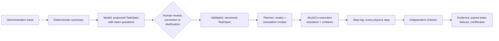

# MIRROR

**Teach a simulated robot what you mean, then test its understanding.**

MIRROR is a robot task-authoring and testing studio built on MuJoCo. You
demonstrate a task, inspect what the system thinks matters, change the world,
correct one misunderstanding in plain language, and then test whether that
correction changes what the robot does in layouts it has never seen.

It is not a video-to-animation generator. Every motion you see is produced by
position-controlled actuators and contact physics, and every verdict comes
from an independent checker that reads the simulator's step log, never from a
model's description of what happened.

> *"I corrected it once, and the correction changed what it did somewhere else."*

## The story in one scene

| Step | What happens |
|---|---|
| **Watch me** | An operator teleoperates a gripper to pack a cup (with eight beads in it), a block and a marker into a tray, carrying everything around a tall wall. |
| **Interpretation** | A model proposes a task specification: goals, constraints and the open questions it could not settle. *"The cup stayed upright the whole time. Required, or incidental?"* Nothing inferred is enforced until a person confirms it. |
| **Your turn** | The robot plans and executes the reviewed task in the same scene. |
| **Change the world** | The tray moves and the wall gains a low slot. The shortest route takes the cup through the slot on its side. The robot does it, sets the cup down upright, and passes the specification it was given, while the beads lie on the table. |
| **"You misunderstood this"** | *"This container must remain upright throughout transport, not just at the destination."* The compiler turns that into one scoped change: an upright rule for the cup during transport. The old trajectory is re-checked and rejected under the new rule. The new plan goes around the wall. |
| **Somewhere new** | Original and corrected specifications are frozen, then run from identical initial states on fresh layouts. Every attempt is reported. In a layout where the slot is the only way through, the robot stops and shows why, instead of breaking the rule. |

## Quick start

```bash
git clone https://github.com/harsha-iiiv/MIRROR && cd MIRROR
python -m venv .venv && . .venv/bin/activate
pip install -e ".[dev]"

mirror doctor            # checks MuJoCo and the model configuration
mirror story             # runs the whole narrative above and prints a transcript
mirror studio            # opens the interactive studio at http://127.0.0.1:8000
pytest -q -m "not slow"  # fast test suite
```

### Model configuration

Interpretation, correction compiling and clarification use an
OpenAI-compatible chat endpoint. The default target is **Meta Model API**:

```bash
export MODEL_API_KEY=...                         # from dev.meta.ai
export MIRROR_LLM_BASE_URL=https://api.meta.ai/v1  # default
export MIRROR_LLM_MODEL=muse-spark-1.3             # default
export MIRROR_LLM_MODE=live                        # live | record | replay | offline
```

Without a key, `replay` serves recorded responses for the reference scenario,
and `offline` uses a deterministic rule-based interpreter. Every output is
labelled with the interpreter that produced it. See
[docs/CLAIMS.md](docs/CLAIMS.md) for which model produced the recorded
responses.

## How it works



* **Specification, not trajectory.** A `TaskSpec` names roles (the container,
  the block), goals (inside the destination tray), and phase-specific rules
  (upright during transport, upright when placed). It carries provenance and
  status for every rule and transfers to new layouts.
* **Only confirmed rules restrict planning.** The model proposes; a person
  confirms, rejects or corrects. Corrections compile to explicit, scoped
  operations with a version history.
* **Same planner before and after.** The planner and controller are
  identical for every specification version, so behaviour changes come only
  from the specification.
* **Checker reads physics, not prose.** The checker is a pure function of the
  step log and the scene. Any old rollout can be re-checked against any later
  specification version.
* **Failure stays visible.** Planning failures, execution failures and
  proven infeasibility are reported separately and never converted into
  success.

More detail: [docs/ARCHITECTURE.md](docs/ARCHITECTURE.md),
[docs/CONTRACTS.md](docs/CONTRACTS.md), [docs/EVALUATION.md](docs/EVALUATION.md),
[docs/CLAIMS.md](docs/CLAIMS.md), and the concept brief
[docs/CONCEPT.md](docs/CONCEPT.md).

## Repository layout

| Path | Contents |
|---|---|
| `mirror/contracts.py` | Shared data types: scenes, demos, task specs, plans, rollout reports |
| `mirror/sim`, `mirror/scenes` | MuJoCo model builder, executor, teleoperation, reference and sampled layouts |
| `mirror/interpret` | Demo summary, model client, specification proposal, correction compiler, clarification |
| `mirror/plan` | Grounding, route and orientation-mode planning, infeasibility certificates |
| `mirror/evaluate` | Step-log checker, paired evaluation, freeze manifest, reports |
| `mirror/studio`, `web/` | Studio backend and browser frontend |
| `mirror/pipeline.py` | `Session`: the end-to-end flow used by the CLI and the studio |
| `data/` | Reference demonstration and recorded model responses |
| `results/` | Evaluation reports |

## License

MIT
