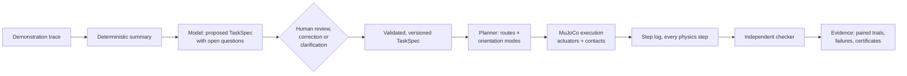

# MIRROR

**Teach a simulated robot what you mean, then test its understanding.**

MIRROR is a robot task-authoring and testing studio built on MuJoCo. You
demonstrate a task, inspect what the system thinks matters, change the world,
correct one misunderstanding in plain language, and then test whether that
correction changes what the robot does in layouts it has never seen.

It is not a video-to-animation generator. Every motion you see is produced by
position-controlled actuators and contact physics, and every verdict comes
from an independent checker that reads the simulator's step log, never from a
model's description of what happened.

> *"I corrected it once, and the correction changed what it did somewhere else."*

## Scope at a glance

* **Simulation only.** MuJoCo physics; no physical robot, no sim-to-real claim.
* **Robot:** a free-flying parallel-jaw gripper on six actuated axes (no arm
  body). Grasps are friction grasps; objects are never moved by anything but
  actuators and contacts. This baseline produced every evaluation result. An
  optional articulated arm backend (simulated UR10e or UR5e) runs the same
  scenes and specifications; see [Arm backend (optional)](#arm-backend-optional).
* **Demonstration:** a scripted teleoperation trace through the same command
  interface a person uses in the studio. Not human-video understanding.
* **Model:** Meta Model API (Muse Spark, `muse-spark-1.3`). Recorded Muse Spark
  responses in `data/cassettes_muse` replay the story and the second evaluation
  without a key. Four more Meta models have measured roles; see
  [Meta models in MIRROR](#meta-models-in-mirror). The first evaluation's recordings came from a development model
  and are labelled as such.
* **Proofs are narrow.** "Infeasible" is claimed only with a geometric bound
  under stated assumptions; otherwise the planner reports that it found no
  plan, which is not a proof.
* **What the headline numbers test.** One specification pair (before and after
  one correction) is compiled once, frozen, and then executed on layouts that
  did not exist before the freeze. The layouts are new; the demonstration, the
  correction sentence and both specifications are not. The results show that one
  compiled correction carries through planning and physics to new layouts. They
  are not 90 new demonstrations interpreted, and not 90 independent
  language-understanding trials. See [Scope of each result](docs/EVALUATION.md#scope-of-each-result).

Full list: [docs/CLAIMS.md](docs/CLAIMS.md).

## The story in one scene

| Step | What happens |
|---|---|
| **Watch me** | An operator teleoperates a gripper to pack a cup (with eight beads in it), a block and a marker into a tray, carrying everything around a tall wall. |
| **Interpretation** | A model proposes a task specification: goals, constraints and the open questions it could not settle. *"The cup stayed upright the whole time. Required, or incidental?"* Nothing inferred is enforced until a person confirms it. |
| **Your turn** | The robot plans and executes the reviewed task in the same scene. |
| **Change the world** | The tray moves and the wall gains a low slot. The shortest route takes the cup through the slot on its side. The robot does it, sets the cup down upright, and passes the specification it was given, while the beads lie on the table. |
| **"You misunderstood this"** | *"This container must remain upright throughout transport, not just at the destination."* The compiler turns that into one scoped change: an upright rule for the cup during transport. The old trajectory is re-checked and rejected under the new rule. The new plan goes around the wall. |
| **Somewhere new** | Original and corrected specifications are frozen, then run from identical initial states on fresh layouts. Every attempt is reported. In a layout where the slot is the only way through, the robot stops and shows why, instead of breaking the rule. |

## Results

Two pre-registered evaluations, each on layouts generated only after the code,
both specification versions and the seed lists were frozen
([details](docs/EVALUATION.md)). Each runs one fixed specification pair (the
original specification and the same specification after the reference
correction) on 60 fresh layouts and 30 shortcut layouts, with 5 blocked layouts
reported separately. The second pair was compiled by **Muse Spark**
(`muse-spark-1.3`, replayed from recordings); the first pair came from recorded
responses of a development model. Both pairs enforce the same rules. Every
layout is new, but each evaluation interprets the demonstration and compiles the
correction only once: these numbers measure transfer of one correction to new
layouts, not how often new corrections are understood.

| | First: fresh (60) | First: shortcut (30) | Muse Spark: fresh (60) | Muse Spark: shortcut (30) |
|---|---|---|---|---|
| Original spec: success without violating "upright during transport" | 27 / 60 | 4 / 30 | 33 / 60 | 3 / 30 |
| Corrected spec: same | **60 / 60** | **30 / 30** | **60 / 60** | **30 / 30** |
| Beads lost, original → corrected | 119 → 0 | 106 → 0 | 104 → 0 | 103 → 0 |
| Unrelated objects still allowed to tilt | 32 / 32 | 25 / 25 | 33 / 33 | 23 / 23 |
| Paired exact McNemar | p = 2.3 × 10⁻¹⁰ | p = 3.0 × 10⁻⁸ | p = 1.5 × 10⁻⁸ | p = 1.5 × 10⁻⁸ |

Full reports: [first](results/eval/report.md), [Muse Spark](results/eval_muse/report.md)
([run notes](results/eval_muse/RUN_NOTES.md)).

Which evidence appears where: the published studio site loads the **Muse Spark**
evaluation (seeds 50000+ and 60000+). The demo film's side-by-side and grid
clips show rollouts from the **first** evaluation (seeds 30000+, development-model
specifications). Both are labelled in
[Evidence provenance](docs/EVALUATION.md#evidence-provenance).

A new protocol for a genuinely fresh authoring evaluation (independent correction
authors, held-out cases, baselines) is written and dry-run on development cases,
but **not yet run**: [docs/protocols/v3_authoring.md](docs/protocols/v3_authoring.md).

How to read these numbers (audit of 2 November 2026; details in
[Audit findings](docs/EVALUATION.md#audit-findings-and-narrowed-claims-2-november-2026)):

* **Not evidence that Muse Spark caused the improvement.** Before either
  evaluation runs, the replayed model specifications must equal the
  offline-rule specifications (`mirror/evaluate/specs.py`). That is a
  deterministic regression check, and it means the offline rules alone would
  give the same layout results. The table shows the effect of the corrected
  rule. Language understanding is measured separately (prepared, not run:
  [protocol v3, language track](docs/protocols/v3_language.md)).
* **The size of the original specification's failure rate depends on the
  planner's objective.** Route cost charges 0.05 m per radian of gripper
  rotation, so the tilted slot route is often cheapest when nothing forbids
  it. An audit's plan-only sweep over the 90 frozen layouts found tilted cup
  routes on 54 at 0.05, 32 at 0.10, 2 at 0.20 and none at 0.40 or 1.0 (planned,
  not executed). The shortest route is not the fastest: in 110 of the 113 pairs
  where the specifications differed, the corrected upright run finished sooner
  in simulation (median 3.6 s; from the stored reports). A cautious planner
  that never tilts would not spill at all. **PENDING (track `baseline`):** an
  executed rotation-cost sweep, a time-calibrated objective and a never-tilt
  baseline, as a new registration.
* **Reproduced at the outcome level.** An isolated, network-blocked replay at
  the audited commit reproduced all 95 Muse-registration scene hashes, statuses
  and violation-free outcomes; one bead-loss count differed (6 vs 2). That is
  reproduction of outcomes, not bit-exact determinism.

No planning failures, execution failures, timeouts or obstacle contacts in
either condition of either evaluation. On five layouts per evaluation where the
slot is the only way through, the original specification spills beads to finish
the task; the corrected one stops with a proof that the rule cannot be met
(10/10 proven, each confirmed by an independent bound).

## Meta models in MIRROR

Five Meta models, each with one job. None of them moves the robot or grades a
run: motion comes from the planner and the physics, verdicts from the checker.

| Model | Job in MIRROR | Why this model | Evidence |
|---|---|---|---|
| **Muse Spark** (`muse-spark-1.3`) | Proposes the task specification from the demonstration, compiles corrections into scoped rule changes, asks clarifying questions. In the video path it also locates the objects on the first frame so SAM can track them, and it is the video observer (kept over Muse Wonder by a rule stated before the test). | Strict JSON-schema output, and text, image and video input in one model. | [Second evaluation](results/eval_muse/report.md): its one specification pair on new layouts, 33/60 → 60/60 and 3/30 → 30/30; the pair had to equal the offline-rule pair (a deterministic regression check), so this does not show Muse Spark caused the improvement. [Correction benchmark](results/corrections_benchmark_summary.md): 44/44 and 27/28, a post-hoc model swap on cases already seen during development, not a blind test or a fresh external holdout |
| **Muse Voice Transcribe** (`muse-voice-transcribe-1.0`) | Turns a spoken correction into text for the same correction compiler. | Push-to-talk transcription; median latency 1.0 s in the spoken-correction benchmark. | [Spoken corrections](results/eval_voice/report.md): 3.0% word error rate on clean speech; corrections right from audio 141/144 vs 142/144 from text |
| **SAM 3.1** (`sam-3.1`) | Tracks the cup, block, marker and gripper through a demonstration video and segments the table, tray and wall, so the demonstration can be rebuilt from video. | Video segmentation with object identities kept across frames. | [Video benchmark](results/eval_video2/report.md), 16 of 20 seeds. Met as registered: median position error 0.72 cm, counted only for estimates within 5 cm of the truth (so it is conditional on detection, not overall accuracy), and cup tilt error 2.0°, which is not informative because the cup never tilted more than 0.3° in any clip (an estimate of always zero would score better). **Not met:** objects found 0.886 (target 0.95), grasp/release within 1 s 0.635 (target 0.9), median timing error 0.65 s (target 0.3 s), same specification as from the true trace on 8 of 16 seeds (target 18 of 20). One seed tracked nothing. Also [robustness](results/eval_robustness/report.md). |
| **Muse Image** (`muse-image-1.0`) | Edits frames (lighting, background, distractors, material) to test whether segmentation holds up when the scene looks different. | Instruction-based edits of a frame whose true masks are still known from the simulator. | [Robustness](results/eval_robustness/report.md): on objects whose position the edit kept, median IoU change about 0 and centroid error under 2 px; that median includes objects no phrase was chosen for (0 before, 0 after), and the found-rate check failed in both conditions. **PENDING (track `reanalysis`):** prompted and evaluated object counts, detection-conditional and unconditional scores |
| **Muse Wonder** (`muse-wonder-1.0`) | Tested as the video observer (objects, grasp and release events, care cues) against Muse Spark on the same clips. Not used: the pre-stated rule kept Muse Spark. | The alternative video model, to be used only if it beat Spark by a margin stated before the test. | [Video benchmark](results/eval_video2/report.md), 16 clips: event F1 0.062 vs Spark 0.115, relevant objects right 14 vs 16, $3.86 vs $0.76, median latency 79 s vs 42 s |

Every model call is recorded, so the story and the published results replay
without a key. What each test does not show is in [docs/CLAIMS.md](docs/CLAIMS.md)
and [docs/EVALUATION.md](docs/EVALUATION.md).

## Quick start

No key is needed: recorded model responses replay the story, the studio and the
published results.

```bash
sudo apt-get install -y libosmesa6 libgl1 ffmpeg   # headless rendering and media tools
git clone https://github.com/harsha-iiiv/MIRROR && cd MIRROR
python3.11 -m venv .venv && . .venv/bin/activate
pip install -r requirements-lock.txt && pip install -e . --no-deps   # tested versions

export MUJOCO_GL=osmesa MIRROR_LLM_MODE=replay MIRROR_META_MODE=replay
mirror doctor            # checks MuJoCo and lists the recordings that will be used
mirror story             # runs the whole narrative above and prints a transcript
mirror studio            # opens the interactive studio at http://127.0.0.1:8000
python -m pytest -q -m "not slow"  # fast test suite
```

Details, headless rendering, CI and release checks: [docs/INSTALL.md](docs/INSTALL.md).

### Model configuration

Interpretation, correction compiling and clarification use an
OpenAI-compatible chat endpoint. The default target is **Meta Model API**:

```bash
export MODEL_API_KEY=...                         # from dev.meta.ai
export MIRROR_LLM_BASE_URL=https://api.meta.ai/v1  # default
export MIRROR_LLM_MODEL=muse-spark-1.3             # default
export MIRROR_LLM_MODE=live                        # live | record | replay | offline
```

Without a key, `replay` serves recorded responses for the reference scenario,
and `offline` uses a deterministic rule-based interpreter. Every output is
labelled with the interpreter that produced it. See
[docs/CLAIMS.md](docs/CLAIMS.md) for which model produced the recorded
responses.

## How it works



* **Specification, not trajectory.** A `TaskSpec` names roles (the container,
  the block), goals (inside the destination tray), and phase-specific rules
  (upright during transport, upright when placed). It carries provenance and
  status for every rule and transfers to new layouts.
* **Only confirmed rules restrict planning.** The model proposes; a person
  confirms, rejects or corrects. Corrections compile to explicit, scoped
  operations with a version history.
* **Same planner before and after.** The planner and controller are
  identical for every specification version, so behaviour changes come only
  from the specification.
* **Checker reads physics, not prose.** The checker is a pure function of the
  step log and the scene. Any old rollout can be re-checked against any later
  specification version.
* **Failure stays visible.** Planning failures, execution failures and
  proven infeasibility are reported separately and never converted into
  success.

More detail: [docs/ARCHITECTURE.md](docs/ARCHITECTURE.md), [docs/INSTALL.md](docs/INSTALL.md),
[docs/CONTRACTS.md](docs/CONTRACTS.md), [docs/EVALUATION.md](docs/EVALUATION.md),
[docs/CLAIMS.md](docs/CLAIMS.md), and the concept brief
[docs/CONCEPT.md](docs/CONCEPT.md).

## Arm backend (optional)

`mirror run --scene demo --backend arm` executes plans on a simulated Universal
Robots UR10e (default) or UR5e carrying the same parallel-jaw gripper. The task
planner, specifications and independent checker are unchanged; the backend
adds inverse kinematics, collision validation of every planned segment and
joint-space execution, and reports `arm_motion_planning_failure` (never a
proof) when it cannot execute any plan. Details and limitations:
[mirror/arm/README.md](mirror/arm/README.md).

* **Optional, not the evaluated robot.** Every evaluation in this README used
  the free-flying gripper baseline. The arm has a development report only
  ([results/arm/v1/report.md](results/arm/v1/report.md)): the reference scenes
  and development layouts 300-309, run on Apple M3 Pro (Darwin arm64), MuJoCo
  3.17.0, Python 3.12.11, at commit `b5b234b`. Physics differs slightly between
  platforms (about 1e-4 m), so compare runs within one platform.
* **The spill-then-correct story happens on the gripper baseline only.** A
  fixed-base arm cannot pass the 0.10 m wall slot with the tool horizontal, so it
  never takes a slot route. In that report the arm's uncorrected runs took no
  slot route and kept 8/8 beads on all 12 layouts it completed (the blocked
  reference scene is a planning failure, not proven), while the gripper's
  uncorrected runs went through the slot on 11 of 13 scenes and violated the
  corrected rule on 8. The correction has nothing to fix on the arm in these
  layouts.
* **Tuned on separate seeds.** The ceiling mount (0.95 m above the table) and
  the 0.30 m tool tube were chosen on development seeds 100-107, which are
  excluded from the report.
* **Simulation only.** Servo gains are chosen, not identified from a robot;
  gravity compensation uses the exact model; contact is MuJoCo's soft model.
  No hardware and no sim-to-real claim.
* **Third-party models.** The UR5e and UR10e models come from MuJoCo Menagerie
  (BSD-3-Clause, Copyright 2018 ROS Industrial Consortium), with visual meshes
  removed and kinematics, inertias, joint ranges and collision geometry
  unchanged. Their licences and `NOTICE` are in `mirror/assets/` and ship in the
  wheel. "Universal Robots", "UR5e" and "UR10e" are trademarks of Universal
  Robots A/S; their use identifies the kinematic model only.

## Repository layout

| Path | Contents |
|---|---|
| `mirror/contracts.py` | Shared data types: scenes, demos, task specs, plans, rollout reports |
| `mirror/sim`, `mirror/scenes` | MuJoCo model builder, executor, teleoperation, reference and sampled layouts |
| `mirror/interpret` | Demo summary, model client, specification proposal, correction compiler, clarification |
| `mirror/plan` | Grounding, route and orientation-mode planning, infeasibility certificates |
| `mirror/arm`, `mirror/assets` | Optional articulated arm backend; vendored UR5e/UR10e models (BSD-3-Clause, see `mirror/assets/NOTICE`) |
| `mirror/evaluate` | Step-log checker, paired evaluation, freeze manifest, reports |
| `mirror/studio`, `web/` | Studio backend and browser frontend |
| `mirror/pipeline.py` | `Session`: the end-to-end flow used by the CLI and the studio |
| `data/` | Reference demonstration and recorded model responses |
| `results/` | Evaluation reports |
| `mirror/evaluate/protocol_v3`, `docs/protocols/` | Fresh authoring evaluation protocol and harness (prepared, not run) |
| `study/` | Impact study kit and a 3-5 person usability pilot (both prepared, not run; fixtures are synthetic) |

## License

MIT, except the vendored robot models in `mirror/assets/`, which are
BSD-3-Clause (MuJoCo Menagerie, from the ROS-Industrial `ur_e_description`);
their licence files and `NOTICE` must stay with any redistribution.
