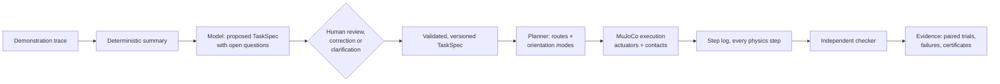

# MIRROR

**Teach a simulated robot what you mean, then test its understanding.**

MIRROR is a robot task-authoring and testing studio built on MuJoCo. You
demonstrate a task, inspect what the system thinks matters, change the world,
correct one misunderstanding in plain language, and then test whether that
correction changes what the robot does in layouts it has never seen.

It is not a video-to-animation generator. Every motion you see is produced by
position-controlled actuators and contact physics, and every verdict comes
from an independent checker that reads the simulator's step log, never from a
model's description of what happened.

> *"I corrected it once, and the correction changed what it did somewhere else."*

## Scope at a glance

* **Simulation only.** MuJoCo physics; no physical robot, no sim-to-real claim.
* **Robot:** a free-flying parallel-jaw gripper on six actuated axes (no arm
  body). Grasps are friction grasps; objects are never moved by anything but
  actuators and contacts.
* **Demonstration:** a scripted teleoperation trace through the same command
  interface a person uses in the studio. Not human-video understanding.
* **Model:** Meta Model API (Muse Spark, `muse-spark-1.3`). Recorded Muse Spark
  responses in `data/cassettes_muse` replay the story and the second evaluation
  without a key. Four more Meta models have measured roles; see
  [Meta models in MIRROR](#meta-models-in-mirror). The first evaluation's recordings came from a development model
  and are labelled as such.
* **Proofs are narrow.** "Infeasible" is claimed only with a geometric bound
  under stated assumptions; otherwise the planner reports that it found no
  plan, which is not a proof.

Full list: [docs/CLAIMS.md](docs/CLAIMS.md).

## The story in one scene

| Step | What happens |
|---|---|
| **Watch me** | An operator teleoperates a gripper to pack a cup (with eight beads in it), a block and a marker into a tray, carrying everything around a tall wall. |
| **Interpretation** | A model proposes a task specification: goals, constraints and the open questions it could not settle. *"The cup stayed upright the whole time. Required, or incidental?"* Nothing inferred is enforced until a person confirms it. |
| **Your turn** | The robot plans and executes the reviewed task in the same scene. |
| **Change the world** | The tray moves and the wall gains a low slot. The shortest route takes the cup through the slot on its side. The robot does it, sets the cup down upright, and passes the specification it was given, while the beads lie on the table. |
| **"You misunderstood this"** | *"This container must remain upright throughout transport, not just at the destination."* The compiler turns that into one scoped change: an upright rule for the cup during transport. The old trajectory is re-checked and rejected under the new rule. The new plan goes around the wall. |
| **Somewhere new** | Original and corrected specifications are frozen, then run from identical initial states on fresh layouts. Every attempt is reported. In a layout where the slot is the only way through, the robot stops and shows why, instead of breaking the rule. |

## Results

Two pre-registered evaluations, each on layouts generated only after the code,
both specification versions and the seed lists were frozen
([details](docs/EVALUATION.md)). The second uses specifications compiled by
**Muse Spark** (`muse-spark-1.3`) on 95 new layouts; the first used recorded
responses from a development model. Both specification pairs enforce the same
rules.

| | First: fresh (60) | First: shortcut (30) | Muse Spark: fresh (60) | Muse Spark: shortcut (30) |
|---|---|---|---|---|
| Original spec: success without violating "upright during transport" | 27 / 60 | 4 / 30 | 33 / 60 | 3 / 30 |
| Corrected spec: same | **60 / 60** | **30 / 30** | **60 / 60** | **30 / 30** |
| Beads lost, original → corrected | 119 → 0 | 106 → 0 | 104 → 0 | 103 → 0 |
| Unrelated objects still allowed to tilt | 32 / 32 | 25 / 25 | 33 / 33 | 23 / 23 |
| Paired exact McNemar | p = 2.3 × 10⁻¹⁰ | p = 3.0 × 10⁻⁸ | p = 1.5 × 10⁻⁸ | p = 1.5 × 10⁻⁸ |

Full reports: [first](results/eval/report.md), [Muse Spark](results/eval_muse/report.md)
([run notes](results/eval_muse/RUN_NOTES.md)).

No planning failures, execution failures, timeouts or obstacle contacts in
either condition of either evaluation. On five layouts per evaluation where the
slot is the only way through, the original specification spills beads to finish
the task; the corrected one stops with a proof that the rule cannot be met
(10/10 proven, each confirmed by an independent bound).

## Meta models in MIRROR

Five Meta models, each with one job. None of them moves the robot or grades a
run: motion comes from the planner and the physics, verdicts from the checker.

| Model | Job in MIRROR | Why this model | Evidence |
|---|---|---|---|
| **Muse Spark** (`muse-spark-1.3`) | Proposes the task specification from the demonstration, compiles corrections into scoped rule changes, asks clarifying questions. In the video path it also locates the objects on the first frame so SAM can track them. | Strict JSON-schema output, and text, image and video input in one model. | [Second evaluation](results/eval_muse/report.md) (its specifications: 33/60 → 60/60, 3/30 → 30/30); [correction benchmark](results/corrections_benchmark_summary.md) |
| **Muse Voice Transcribe** (`muse-voice-transcribe-1.0`) | Turns a spoken correction into text for the same correction compiler. | Push-to-talk transcription; median latency 1.0 s in the spoken-correction benchmark. | [Spoken corrections](results/eval_voice/report.md): 3.0% word error rate on clean speech; corrections right from audio 141/144 vs 142/144 from text |
| **SAM 3.1** (`sam-3.1`) | Tracks the cup, block, marker and gripper through a demonstration video and segments the table, tray and wall, so the demonstration can be rebuilt from video. | Video segmentation with object identities kept across frames. | [Robustness](results/eval_robustness/report.md); [video registration](results/eval_video/) (results pending) |
| **Muse Image** (`muse-image-1.0`) | Edits frames (lighting, background, distractors, material) to test whether segmentation holds up when the scene looks different. | Instruction-based edits of a frame whose true masks are still known from the simulator. | [Robustness](results/eval_robustness/report.md): on objects whose position the edit kept, median IoU change about 0 and centroid error under 2 px |
| **Muse Wonder** (`muse-wonder-1.0`) | Watches the demonstration video and reports objects, grasp and release events and care cues, compared against Muse Spark doing the same. | The alternative video model, kept only if it beats Spark by a margin stated before the test. | [Video registration](results/eval_video/) (results pending) |

Every model call is recorded, so the story and the published results replay
without a key. What each test does not show is in [docs/CLAIMS.md](docs/CLAIMS.md)
and [docs/EVALUATION.md](docs/EVALUATION.md).

## Quick start

```bash
git clone https://github.com/harsha-iiiv/MIRROR && cd MIRROR
python -m venv .venv && . .venv/bin/activate
pip install -e ".[dev]"

mirror doctor            # checks MuJoCo and the model configuration
mirror story             # runs the whole narrative above and prints a transcript
mirror studio            # opens the interactive studio at http://127.0.0.1:8000
python -m pytest -q -m "not slow"  # fast test suite
```

### Model configuration

Interpretation, correction compiling and clarification use an
OpenAI-compatible chat endpoint. The default target is **Meta Model API**:

```bash
export MODEL_API_KEY=...                         # from dev.meta.ai
export MIRROR_LLM_BASE_URL=https://api.meta.ai/v1  # default
export MIRROR_LLM_MODEL=muse-spark-1.3             # default
export MIRROR_LLM_MODE=live                        # live | record | replay | offline
```

Without a key, `replay` serves recorded responses for the reference scenario,
and `offline` uses a deterministic rule-based interpreter. Every output is
labelled with the interpreter that produced it. See
[docs/CLAIMS.md](docs/CLAIMS.md) for which model produced the recorded
responses.

## How it works



* **Specification, not trajectory.** A `TaskSpec` names roles (the container,
  the block), goals (inside the destination tray), and phase-specific rules
  (upright during transport, upright when placed). It carries provenance and
  status for every rule and transfers to new layouts.
* **Only confirmed rules restrict planning.** The model proposes; a person
  confirms, rejects or corrects. Corrections compile to explicit, scoped
  operations with a version history.
* **Same planner before and after.** The planner and controller are
  identical for every specification version, so behaviour changes come only
  from the specification.
* **Checker reads physics, not prose.** The checker is a pure function of the
  step log and the scene. Any old rollout can be re-checked against any later
  specification version.
* **Failure stays visible.** Planning failures, execution failures and
  proven infeasibility are reported separately and never converted into
  success.

More detail: [docs/ARCHITECTURE.md](docs/ARCHITECTURE.md),
[docs/CONTRACTS.md](docs/CONTRACTS.md), [docs/EVALUATION.md](docs/EVALUATION.md),
[docs/CLAIMS.md](docs/CLAIMS.md), and the concept brief
[docs/CONCEPT.md](docs/CONCEPT.md).

## Repository layout

| Path | Contents |
|---|---|
| `mirror/contracts.py` | Shared data types: scenes, demos, task specs, plans, rollout reports |
| `mirror/sim`, `mirror/scenes` | MuJoCo model builder, executor, teleoperation, reference and sampled layouts |
| `mirror/interpret` | Demo summary, model client, specification proposal, correction compiler, clarification |
| `mirror/plan` | Grounding, route and orientation-mode planning, infeasibility certificates |
| `mirror/evaluate` | Step-log checker, paired evaluation, freeze manifest, reports |
| `mirror/studio`, `web/` | Studio backend and browser frontend |
| `mirror/pipeline.py` | `Session`: the end-to-end flow used by the CLI and the studio |
| `data/` | Reference demonstration and recorded model responses |
| `results/` | Evaluation reports |

## License

MIT
