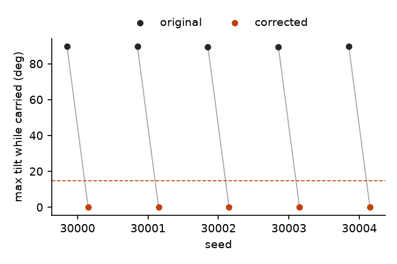
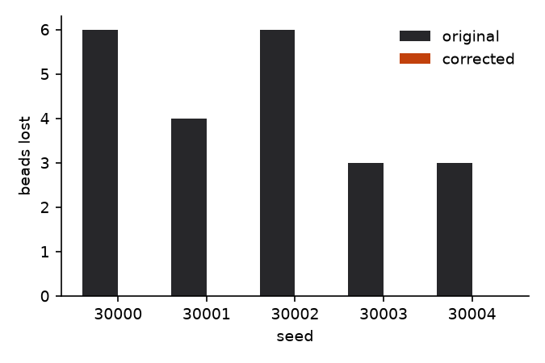
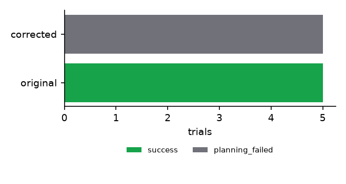
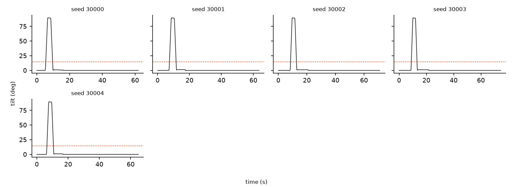

# MIRROR paired evaluation: blocked

Split: **blocked**, 5 paired scenes, 10 trials. Every attempt is listed below.

## Freeze

- Manifest created 2026-10-31T13:50:32.746526+00:00
- Spec A `spec_demo_ref_demo_reference` v2 sha256 `546ca656ea2952f2`
- Spec B `spec_demo_ref_demo_reference` v3 sha256 `baafa260a6834153`
- Code sha256 `b498c4b41664c589` over 65 source files
- Seeds: 30000, 30001, 30002, 30003, 30004, 30005, 30006, 30007, 30008, 30009, 30010, 30011, 30012, 30013, 30014, 30015, 30016, 30017, 30018, 30019, 30020, 30021, 30022, 30023, 30024, 30025, 30026, 30027, 30028, 30029, 30030, 30031, 30032, 30033, 30034, 30035, 30036, 30037, 30038, 30039, 30040, 30041, 30042, 30043, 30044, 30045, 30046, 30047, 30048, 30049, 30050, 30051, 30052, 30053, 30054, 30055, 30056, 30057, 30058, 30059, 40000, 40001, 40002, 40003, 40004, 40005, 40006, 40007, 40008, 40009, 40010, 40011, 40012, 40013, 40014, 40015, 40016, 40017, 40018, 40019, 40020, 40021, 40022, 40023, 40024, 40025, 40026, 40027, 40028, 40029, 30000, 30001, 30002, 30003, 30004

## Corrected rules (enforced in B, not in A)

- `c_upright_transport_cup`: upright on kind=cup during transport, params {'max_tilt_deg': 15.0}

## Metrics (reported separately, not combined)

| Metric | A: original | B: corrected |
|---|---|---|
| Trials executed in simulation | 5/5 | 0/5 |
| Task completion | 5/5 | 0/5 |
| Violation-free success | 0/5 | 0/5 |
| Trials violating corrected rules | 5 | 0 |
| Max tilt of corrected objects, mean / max (deg) | 89.6 / 89.7 | n/a / n/a |
| Time over tolerance, mean (s) | 4.15 | n/a |
| Beads lost, total (mean per executed trial) | 22 (4.4) | 0 (n/a) |
| Trials with forbidden contacts | 0 | 0 |
| Trials with any obstacle or floor contact (spec-independent) | 0 | 0 |
| Planning failures | 0 | 5 |
| Execution failures | 0 | 0 |
| Timeouts | 0 | 0 |
| Planning time, mean (s) | 0.873 | 0.760 |
| Execution time, mean simulated (s) | 67.3 | n/a |
| Human interventions | 0 | 0 |
| Feasible scenes wrongly rejected (of known feasible) | 0 of 0 | 0 of 0 |

## Paired statistics

The correction was exercised in 5 of 5 scenes (the original specification's rollout violated a corrected rule: seeds 30000, 30001, 30002, 30003, 30004). In the other scenes both versions may legitimately behave the same.

Violation-free success: A 0.00 (95% Wilson [0.00, 0.43]), B 0.00 ([0.00, 0.43]). Difference B - A +0.00, bootstrap 95% CI [0.00, 0.00].

Pairs: both 0, only A 0, only B 0, neither 5. Exact McNemar p = 1. 0 discordant pair(s) of 5; exact McNemar needs at least 6 discordant pairs all in one direction to reach p < 0.05, so this sample cannot establish significance either way.

Corrected-rule compliance (executed and no violation): A 0.00, B 0.00, McNemar p = 1.

Beads lost per scene: mean difference B - A -4.40, bootstrap 95% CI [-5.60, -3.20].

Previously successful scenes kept: 0 of 0 scenes where A succeeded without violating the corrected rules; 0 of 5 scenes where A succeeded under its own specification also succeeded under B.

## Scope regression

no unrelated object took a tilted route in the original runs; scope not exercised.

## Every attempt

| seed | scene | A status | A tilt | A beads lost | B status | B tilt | B beads lost | notes |
|---|---|---|---|---|---|---|---|---|
| 30000 | blocked_30000 | success | 90 | 6 | planning_failed | 0 | 0 | proven_infeasible |
| 30001 | blocked_30001 | success | 90 | 4 | planning_failed | 0 | 0 | proven_infeasible |
| 30002 | blocked_30002 | success | 90 | 6 | planning_failed | 0 | 0 | proven_infeasible |
| 30003 | blocked_30003 | success | 90 | 3 | planning_failed | 0 | 0 | proven_infeasible |
| 30004 | blocked_30004 | success | 90 | 3 | planning_failed | 0 | 0 | proven_infeasible |

## Figures

## Where simulator ground truth is used

- object positions and orientations: simulator body state at every physics step (tilt, placement, settling)
- held object: executor's finger-contact detection logged per step (transport phase boundaries)
- bead positions: simulator body state (bead retention)
- contacts: simulator contact list, classified by geom group (forbidden contacts)
- scene geometry: SceneState dimensions (tray footprint, cup interior, obstacle boxes)

## Simplifications

- Completion uses the object's centre: inside the tray's inner footprint (minus inside_margin_m) and above its floor.
- Settled means linear speed below tolerances.settle_speed_mps over the last 0.3 s of the log; angular speed is not checked.
- Transport phase = the executor's per-step held label (finger contacts; gaps up to 0.5 s bridged) plus, between first grasp and last release, steps where the object is more than 5 mm above its resting height and touches no support.
- Bead retention counts bead centres inside the cup interior box (2 mm tolerance) at the final step.
- keep_clearance uses a bounding-sphere distance to obstacle boxes (conservative).
- Upright-route feasibility witness is a clearance condition, not a constructed trajectory; scenes with box obstacles are 'unknown'.
- The independent infeasibility proof covers any motion of a rigidly top-grasped object (tool centre on its axis, palm above its top, grasp depth 0 to the palm's lower face) with the tool centre in the workspace; it uses a 0.1 mm strictness margin (CONTACT_FREE_EPS_M). Only planner records with proven: true count as planner proofs.

Finite simulated trials; not formal verification and not evidence of physical deployment.
