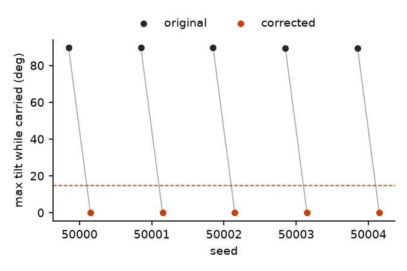
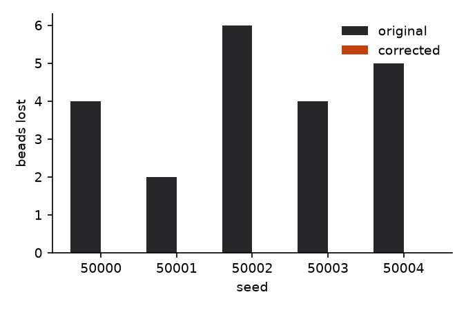
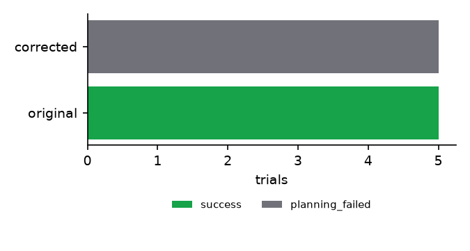
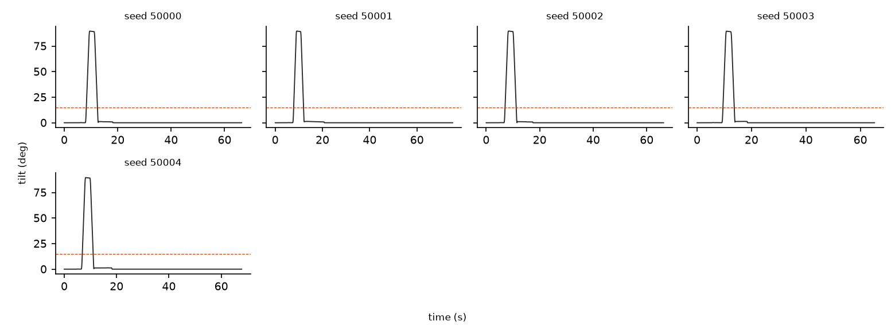

# MIRROR paired evaluation: blocked

Split: **blocked**, 5 paired scenes, 10 trials. Every attempt is listed below.

## Freeze

- Manifest created 2026-10-31T16:34:38.113695+00:00
- Spec A `spec_demo_ref_demo_reference` v2 sha256 `7b18030c5cbbadd3`
- Spec B `spec_demo_ref_demo_reference` v3 sha256 `7ee3ac0153407424`
- Code sha256 `e77c4cec9c4d414d` over 59 source files (presentation-only paths not hashed: sim/render.py, studio/**, cli.py)
- Seeds: 50000, 50001, 50002, 50003, 50004, 50005, 50006, 50007, 50008, 50009, 50010, 50011, 50012, 50013, 50014, 50015, 50016, 50017, 50018, 50019, 50020, 50021, 50022, 50023, 50024, 50025, 50026, 50027, 50028, 50029, 50030, 50031, 50032, 50033, 50034, 50035, 50036, 50037, 50038, 50039, 50040, 50041, 50042, 50043, 50044, 50045, 50046, 50047, 50048, 50049, 50050, 50051, 50052, 50053, 50054, 50055, 50056, 50057, 50058, 50059, 60000, 60001, 60002, 60003, 60004, 60005, 60006, 60007, 60008, 60009, 60010, 60011, 60012, 60013, 60014, 60015, 60016, 60017, 60018, 60019, 60020, 60021, 60022, 60023, 60024, 60025, 60026, 60027, 60028, 60029, 50000, 50001, 50002, 50003, 50004

## Corrected rules (enforced in B, not in A)

- `c_upright_transport_cup`: upright on kind=cup during transport, params {'max_tilt_deg': 15.0}

## Metrics (reported separately, not combined)

| Metric | A: original | B: corrected |
|---|---|---|
| Trials executed in simulation | 5/5 | 0/5 |
| Task completion | 5/5 | 0/5 |
| Violation-free success | 0/5 | 0/5 |
| Trials violating corrected rules | 5 | 0 |
| Max tilt of corrected objects, mean / max (deg) | 89.6 / 89.7 | n/a / n/a |
| Time over tolerance, mean (s) | 4.15 | n/a |
| Beads lost, total (mean per executed trial) | 21 (4.2) | 0 (n/a) |
| Trials with forbidden contacts | 0 | 0 |
| Trials with any obstacle or floor contact (spec-independent) | 0 | 0 |
| Planning failures | 0 | 5 |
| Execution failures | 0 | 0 |
| Timeouts | 0 | 0 |
| Planning time, mean (s) | 0.082 | 0.071 |
| Execution time, mean simulated (s) | 68.2 | n/a |
| Human interventions | 0 | 0 |
| Feasible scenes wrongly rejected (of known feasible) | 0 of 0 | 0 of 0 |

## Paired statistics

The correction was exercised in 5 of 5 scenes (the original specification's rollout violated a corrected rule: seeds 50000, 50001, 50002, 50003, 50004). In the other scenes both versions may legitimately behave the same.

Violation-free success: A 0.00 (95% Wilson [0.00, 0.43]), B 0.00 ([0.00, 0.43]). Difference B - A +0.00, bootstrap 95% CI [0.00, 0.00].

Pairs: both 0, only A 0, only B 0, neither 5. Exact McNemar p = 1. 0 discordant pair(s) of 5; exact McNemar needs at least 6 discordant pairs all in one direction to reach p < 0.05, so this sample cannot establish significance either way.

Corrected-rule compliance (executed and no violation): A 0.00, B 0.00, McNemar p = 1.

Beads lost per scene: mean difference B - A -4.20, bootstrap 95% CI [-5.40, -3.00].

Previously successful scenes kept: 0 of 0 scenes where A succeeded without violating the corrected rules; 0 of 5 scenes where A succeeded under its own specification also succeeded under B.

## Scope regression

no unrelated object took a tilted route in the original runs; scope not exercised.

## Every attempt

| seed | scene | A status | A tilt | A beads lost | B status | B tilt | B beads lost | notes |
|---|---|---|---|---|---|---|---|---|
| 50000 | blocked_50000 | success | 90 | 4 | planning_failed | 0 | 0 | proven_infeasible |
| 50001 | blocked_50001 | success | 90 | 2 | planning_failed | 0 | 0 | proven_infeasible |
| 50002 | blocked_50002 | success | 90 | 6 | planning_failed | 0 | 0 | proven_infeasible |
| 50003 | blocked_50003 | success | 90 | 4 | planning_failed | 0 | 0 | proven_infeasible |
| 50004 | blocked_50004 | success | 90 | 5 | planning_failed | 0 | 0 | proven_infeasible |

## Figures

## Where simulator ground truth is used

- object positions and orientations: simulator body state at every physics step (tilt, placement, settling)
- held object: executor's finger-contact detection logged per step (transport phase boundaries)
- bead positions: simulator body state (bead retention)
- contacts: simulator contact list, classified by geom group (forbidden contacts)
- scene geometry: SceneState dimensions (tray footprint, cup interior, obstacle boxes)

## Simplifications

- Completion uses the object's centre: inside the tray's inner footprint (minus inside_margin_m) and above its floor.
- Settled means linear speed below tolerances.settle_speed_mps over the last 0.3 s of the log; angular speed is not checked.
- Transport phase = the executor's per-step held label (finger contacts; gaps up to 0.5 s bridged) plus, between first grasp and last release, steps where the object is more than 5 mm above its resting height and touches no support.
- Bead retention counts bead centres inside the cup interior box (2 mm tolerance) at the final step.
- keep_clearance uses a bounding-sphere distance to obstacle boxes (conservative).
- Upright-route feasibility witness is a clearance condition, not a constructed trajectory; scenes with box obstacles are 'unknown'.
- The independent infeasibility proof covers any motion of a rigidly top-grasped object (tool centre on its axis, palm above its top, grasp depth 0 to the palm's lower face) with the tool centre in the workspace; it uses a 0.1 mm strictness margin (CONTACT_FREE_EPS_M). Only planner records with proven: true count as planner proofs.

Finite simulated trials; not formal verification and not evidence of physical deployment.
