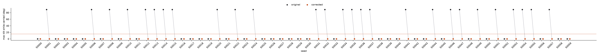
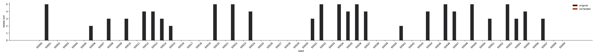
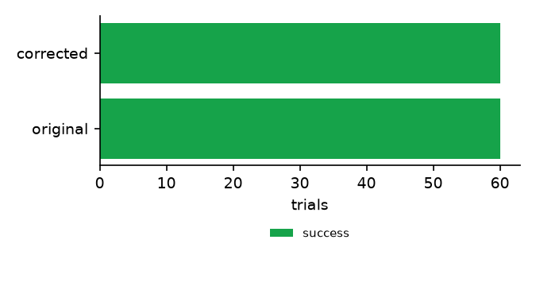
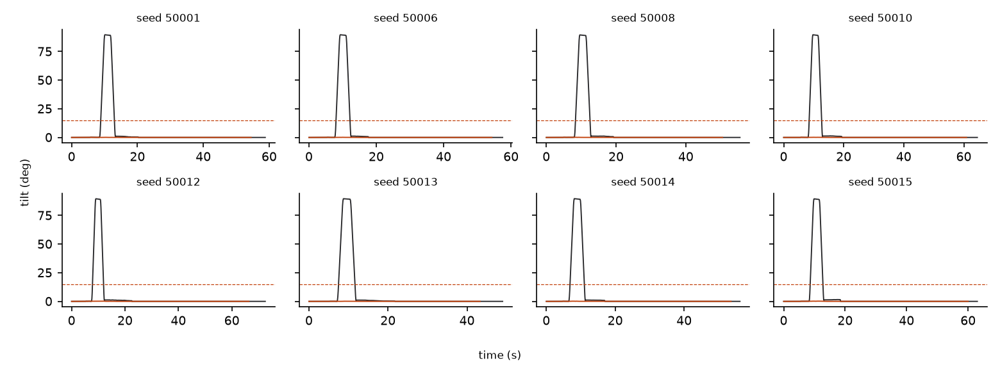

# MIRROR paired evaluation: primary

Split: **eval**, 60 paired scenes, 120 trials. Every attempt is listed below.

## Freeze

- Manifest created 2026-10-31T16:34:38.113695+00:00 (written before layouts were generated)
- Spec A `spec_demo_ref_demo_reference` v2 sha256 `7b18030c5cbbadd3`
- Spec B `spec_demo_ref_demo_reference` v3 sha256 `7ee3ac0153407424`
- Code sha256 `e77c4cec9c4d414d` over 59 source files (presentation-only paths not hashed: sim/render.py, studio/**, cli.py)
- Seeds: 50000, 50001, 50002, 50003, 50004, 50005, 50006, 50007, 50008, 50009, 50010, 50011, 50012, 50013, 50014, 50015, 50016, 50017, 50018, 50019, 50020, 50021, 50022, 50023, 50024, 50025, 50026, 50027, 50028, 50029, 50030, 50031, 50032, 50033, 50034, 50035, 50036, 50037, 50038, 50039, 50040, 50041, 50042, 50043, 50044, 50045, 50046, 50047, 50048, 50049, 50050, 50051, 50052, 50053, 50054, 50055, 50056, 50057, 50058, 50059, 60000, 60001, 60002, 60003, 60004, 60005, 60006, 60007, 60008, 60009, 60010, 60011, 60012, 60013, 60014, 60015, 60016, 60017, 60018, 60019, 60020, 60021, 60022, 60023, 60024, 60025, 60026, 60027, 60028, 60029, 50000, 50001, 50002, 50003, 50004

## Corrected rules (enforced in B, not in A)

- `c_upright_transport_cup`: upright on kind=cup during transport, params {'max_tilt_deg': 15.0}

## Metrics (reported separately, not combined)

| Metric | A: original | B: corrected |
|---|---|---|
| Trials executed in simulation | 60/60 | 60/60 |
| Task completion | 60/60 | 60/60 |
| Violation-free success | 33/60 | 60/60 |
| Trials violating corrected rules | 27 | 0 |
| Max tilt of corrected objects, mean / max (deg) | 40.4 / 89.7 | 0.2 / 0.3 |
| Time over tolerance, mean (s) | 1.87 | 0.00 |
| Beads lost, total (mean per executed trial) | 104 (1.7) | 0 (0.0) |
| Trials with forbidden contacts | 0 | 0 |
| Trials with any obstacle or floor contact (spec-independent) | 0 | 0 |
| Planning failures | 0 | 0 |
| Execution failures | 0 | 0 |
| Timeouts | 0 | 0 |
| Planning time, mean (s) | 0.075 | 0.072 |
| Execution time, mean simulated (s) | 53.5 | 51.8 |
| Human interventions | 0 | 0 |
| Feasible scenes wrongly rejected (of known feasible) | 0 of 40 | 0 of 40 |

## Paired statistics

The correction was exercised in 27 of 60 scenes (the original specification's rollout violated a corrected rule: seeds 50001, 50006, 50008, 50010, 50012, 50013, 50014, 50015, 50020, 50022, 50024, 50031, 50032, 50034, 50035, 50036, 50037, 50041, 50044, 50046, 50047, 50049, 50051, 50053, 50054, 50055, 50057). In the other scenes both versions may legitimately behave the same.

Violation-free success: A 0.55 (95% Wilson [0.42, 0.67]), B 1.00 ([0.94, 1.00]). Difference B - A +0.45, bootstrap 95% CI [0.32, 0.57].

Pairs: both 33, only A 0, only B 27, neither 0. Exact McNemar p = 1.49e-08. 27 discordant pair(s) of 60.

Corrected-rule compliance (executed and no violation): A 0.55, B 1.00, McNemar p = 1.49e-08.

Beads lost per scene: mean difference B - A -1.73, bootstrap 95% CI [-2.23, -1.22].

Previously successful scenes kept: 33 of 33 scenes where A succeeded without violating the corrected rules; 60 of 60 scenes where A succeeded under its own specification also succeeded under B.

## Scope regression

33/33 unrelated-object tilted routes kept under the corrected spec.

| seed | object | max tilt A | max tilt B | still tilted |
|---|---|---|---|---|
| 50000 | marker_0 | 89.4 | 89.4 | True |
| 50005 | marker_0 | 89.4 | 89.4 | True |
| 50006 | marker_0 | 89.4 | 89.4 | True |
| 50007 | marker_0 | 89.4 | 89.4 | True |
| 50010 | block_0 | 90.0 | 90.0 | True |
| 50010 | marker_0 | 89.4 | 89.4 | True |
| 50011 | block_0 | 90.0 | 90.0 | True |
| 50012 | block_0 | 90.0 | 90.0 | True |
| 50015 | block_0 | 90.0 | 90.0 | True |
| 50015 | marker_0 | 89.4 | 89.4 | True |
| 50020 | block_0 | 90.0 | 90.0 | True |
| 50020 | marker_0 | 89.4 | 89.4 | True |
| 50022 | block_0 | 90.0 | 90.0 | True |
| 50022 | marker_0 | 89.4 | 89.4 | True |
| 50024 | block_0 | 90.0 | 90.0 | True |
| 50026 | marker_0 | 89.4 | 89.4 | True |
| 50028 | marker_0 | 89.4 | 89.4 | True |
| 50031 | block_0 | 90.0 | 90.0 | True |
| 50035 | block_0 | 90.0 | 90.0 | True |
| 50036 | marker_0 | 89.4 | 89.4 | True |
| 50037 | marker_0 | 89.4 | 89.4 | True |
| 50041 | block_0 | 90.0 | 90.0 | True |
| 50041 | marker_0 | 89.4 | 89.4 | True |
| 50044 | block_0 | 90.0 | 90.0 | True |
| 50044 | marker_0 | 89.4 | 89.4 | True |
| 50047 | block_0 | 90.0 | 90.0 | True |
| 50049 | block_0 | 89.9 | 89.9 | True |
| 50049 | marker_0 | 89.5 | 89.4 | True |
| 50051 | block_0 | 90.0 | 90.0 | True |
| 50051 | marker_0 | 89.4 | 89.4 | True |
| 50054 | block_0 | 90.0 | 90.0 | True |
| 50054 | marker_0 | 89.4 | 89.4 | True |
| 50055 | block_0 | 90.0 | 90.0 | True |

## Every attempt

| seed | scene | A status | A tilt | A beads lost | B status | B tilt | B beads lost | notes |
|---|---|---|---|---|---|---|---|---|
| 50000 | eval_50000 | success | 0 | 0 | success | 0 | 0 |  |
| 50001 | eval_50001 | success | 90 | 5 | success | 0 | 0 |  |
| 50002 | eval_50002 | success | 0 | 0 | success | 0 | 0 |  |
| 50003 | eval_50003 | success | 0 | 0 | success | 0 | 0 |  |
| 50004 | eval_50004 | success | 0 | 0 | success | 0 | 0 |  |
| 50005 | eval_50005 | success | 0 | 0 | success | 0 | 0 |  |
| 50006 | eval_50006 | success | 90 | 2 | success | 0 | 0 |  |
| 50007 | eval_50007 | success | 0 | 0 | success | 0 | 0 |  |
| 50008 | eval_50008 | success | 90 | 3 | success | 0 | 0 |  |
| 50009 | eval_50009 | success | 0 | 0 | success | 0 | 0 |  |
| 50010 | eval_50010 | success | 90 | 3 | success | 0 | 0 |  |
| 50011 | eval_50011 | success | 0 | 0 | success | 0 | 0 |  |
| 50012 | eval_50012 | success | 90 | 4 | success | 0 | 0 |  |
| 50013 | eval_50013 | success | 90 | 4 | success | 0 | 0 |  |
| 50014 | eval_50014 | success | 90 | 3 | success | 0 | 0 |  |
| 50015 | eval_50015 | success | 90 | 2 | success | 0 | 0 |  |
| 50016 | eval_50016 | success | 0 | 0 | success | 0 | 0 |  |
| 50017 | eval_50017 | success | 0 | 0 | success | 0 | 0 |  |
| 50018 | eval_50018 | success | 0 | 0 | success | 0 | 0 |  |
| 50019 | eval_50019 | success | 0 | 0 | success | 0 | 0 |  |
| 50020 | eval_50020 | success | 90 | 5 | success | 0 | 0 |  |
| 50021 | eval_50021 | success | 0 | 0 | success | 0 | 0 |  |
| 50022 | eval_50022 | success | 90 | 5 | success | 0 | 0 |  |
| 50023 | eval_50023 | success | 0 | 0 | success | 0 | 0 |  |
| 50024 | eval_50024 | success | 90 | 4 | success | 0 | 0 |  |
| 50025 | eval_50025 | success | 0 | 0 | success | 0 | 0 |  |
| 50026 | eval_50026 | success | 0 | 0 | success | 0 | 0 |  |
| 50027 | eval_50027 | success | 0 | 0 | success | 0 | 0 |  |
| 50028 | eval_50028 | success | 0 | 0 | success | 0 | 0 |  |
| 50029 | eval_50029 | success | 0 | 0 | success | 0 | 0 |  |
| 50030 | eval_50030 | success | 0 | 0 | success | 0 | 0 |  |
| 50031 | eval_50031 | success | 90 | 3 | success | 0 | 0 |  |
| 50032 | eval_50032 | success | 90 | 5 | success | 0 | 0 |  |
| 50033 | eval_50033 | success | 0 | 0 | success | 0 | 0 |  |
| 50034 | eval_50034 | success | 90 | 5 | success | 0 | 0 |  |
| 50035 | eval_50035 | success | 90 | 4 | success | 0 | 0 |  |
| 50036 | eval_50036 | success | 90 | 5 | success | 0 | 0 |  |
| 50037 | eval_50037 | success | 90 | 4 | success | 0 | 0 |  |
| 50038 | eval_50038 | success | 0 | 0 | success | 0 | 0 |  |
| 50039 | eval_50039 | success | 0 | 0 | success | 0 | 0 |  |
| 50040 | eval_50040 | success | 0 | 0 | success | 0 | 0 |  |
| 50041 | eval_50041 | success | 90 | 2 | success | 0 | 0 |  |
| 50042 | eval_50042 | success | 0 | 0 | success | 0 | 0 |  |
| 50043 | eval_50043 | success | 0 | 0 | success | 0 | 0 |  |
| 50044 | eval_50044 | success | 90 | 4 | success | 0 | 0 |  |
| 50045 | eval_50045 | success | 0 | 0 | success | 0 | 0 |  |
| 50046 | eval_50046 | success | 90 | 5 | success | 0 | 0 |  |
| 50047 | eval_50047 | success | 89 | 4 | success | 0 | 0 |  |
| 50048 | eval_50048 | success | 0 | 0 | success | 0 | 0 |  |
| 50049 | eval_50049 | success | 90 | 5 | success | 0 | 0 |  |
| 50050 | eval_50050 | success | 0 | 0 | success | 0 | 0 |  |
| 50051 | eval_50051 | success | 90 | 3 | success | 0 | 0 |  |
| 50052 | eval_50052 | success | 0 | 0 | success | 0 | 0 |  |
| 50053 | eval_50053 | success | 90 | 5 | success | 0 | 0 |  |
| 50054 | eval_50054 | success | 90 | 3 | success | 0 | 0 |  |
| 50055 | eval_50055 | success | 90 | 4 | success | 0 | 0 |  |
| 50056 | eval_50056 | success | 0 | 0 | success | 0 | 0 |  |
| 50057 | eval_50057 | success | 90 | 3 | success | 0 | 0 |  |
| 50058 | eval_50058 | success | 0 | 0 | success | 0 | 0 |  |
| 50059 | eval_50059 | success | 0 | 0 | success | 0 | 0 |  |

## Figures

## Where simulator ground truth is used

- object positions and orientations: simulator body state at every physics step (tilt, placement, settling)
- held object: executor's finger-contact detection logged per step (transport phase boundaries)
- bead positions: simulator body state (bead retention)
- contacts: simulator contact list, classified by geom group (forbidden contacts)
- scene geometry: SceneState dimensions (tray footprint, cup interior, obstacle boxes)

## Simplifications

- Completion uses the object's centre: inside the tray's inner footprint (minus inside_margin_m) and above its floor.
- Settled means linear speed below tolerances.settle_speed_mps over the last 0.3 s of the log; angular speed is not checked.
- Transport phase = the executor's per-step held label (finger contacts; gaps up to 0.5 s bridged) plus, between first grasp and last release, steps where the object is more than 5 mm above its resting height and touches no support.
- Bead retention counts bead centres inside the cup interior box (2 mm tolerance) at the final step.
- keep_clearance uses a bounding-sphere distance to obstacle boxes (conservative).
- Upright-route feasibility witness is a clearance condition, not a constructed trajectory; scenes with box obstacles are 'unknown'.
- The independent infeasibility proof covers any motion of a rigidly top-grasped object (tool centre on its axis, palm above its top, grasp depth 0 to the palm's lower face) with the tool centre in the workspace; it uses a 0.1 mm strictness margin (CONTACT_FREE_EPS_M). Only planner records with proven: true count as planner proofs.

Finite simulated trials; not formal verification and not evidence of physical deployment.
